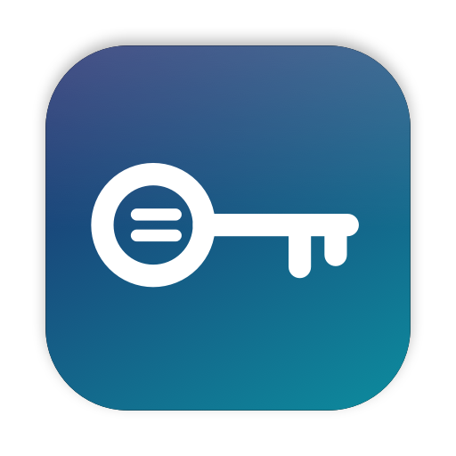

<p align="center"></p>

<h1 align="center">envdesk</h1>

<p align="center"><b>Never paste a secret into your coding AI's chat again.</b></p>

When your AI coding assistant needs an API key, it usually asks you to paste it into the chat or run a terminal command. Either way, the secret ends up in a chat history or a log. With envdesk, you open the app, paste the key in, and press Save. Your assistant then reads it from the project's `.env` file, as your code does, and never sees the key itself.

It's made to be easy. You don't need to know any terminal commands, where a `.env` file lives, or how shell variables work. You pick your project, choose the key's name, paste the value, and it's done.

**Why it exists.** I kept running into this while helping people who aren't developers build something of their own with an AI coding assistant. The code was easy for them. The keys were where it went wrong: pasting them into chat, losing track of which file they went in, or getting stuck on a terminal command. envdesk is the tool I wanted to hand them.

## In short

A small native Mac app for the API keys scattered across your `.env` files and shell profile. Pick a project, paste a key, and it lands in the right file. Browse every key you have, masked, behind Touch ID.

It's two Swift files with no dependencies, no network access and no account. It only reads and writes plain files on your Mac.

**Tell your AI assistant:** "Don't ask me for keys in chat. Tell me the variable name and I'll add it in envdesk." Then check with it afterwards that the key is present, by name only.

## What it does

- **Projects.** Add a folder, and envdesk finds its `.env.local`, `.env`, `.env.development.local` and similar files, one level down too. Switch between projects from a picker.
- **Mac variables.** Keys in `~/.zshenv` are shared across every project. Saving one there also runs `launchctl setenv`, so apps started from Finder see it too.
- **Add or update a key.** Choose a name (or pick a common one, like `OPENAI_API_KEY`), paste the value, tick where it goes, and press Save. The key's line is replaced in place, and every other line, comment and order is kept.
- **Paste many at once.** Paste `KEY=VALUE` lines, a whole `.env` file, or a JSON credentials file. Nested JSON is flattened, so a Google OAuth client file with the prefix `GOOGLE_OAUTH_` gives `GOOGLE_OAUTH_CLIENT_ID` and `GOOGLE_OAUTH_CLIENT_SECRET`. Delete the rows you don't need.
- **Browse safely.**
  - Values are masked.
  - Show and Copy ask for Touch ID or your password, then stay unlocked for 5 minutes.
  - A shown value hides again after 20 seconds.
  - The clipboard clears itself after 30 seconds, unless you've copied something else since.
- **Catch mistakes.**
  - A warning appears when a project's env file isn't ignored by git, so it could be committed.
  - A "differs" badge appears when the same name has different values in different files.
- **Menu bar.** A key icon in the menu bar opens a small panel: pick a project, search, and copy any key with one click, behind Touch ID.
- **Export `.env.example`** with names only, to commit for teammates.
- **Backups.** Every change keeps a `.bak` copy beside the file, and files are set to owner-only (`600`).

## Install

Needs macOS 14 or later and the Xcode command line tools (`xcode-select --install`).

```sh
git clone https://github.com/YashSharmaa/envdesk.git
cd envdesk
./build.sh                # builds ~/Applications/envdesk.app
./build.sh /Applications  # or install it for every user
open ~/Applications/envdesk.app
```

The app is signed ad hoc on your own Mac, so Gatekeeper doesn't block it. The first time it opens a folder in Documents or Desktop, macOS asks for permission.

## Good to know

- These are plain-text files, as your tools expect. envdesk makes them easier and safer to manage, but it doesn't encrypt them. For secrets that must be encrypted at rest, use the macOS Keychain or a secrets manager.
- Values are written in single quotes (`NAME='value'`). That's read correctly by Node (`--env-file`), dotenv, Next.js, Vite, Python's python-dotenv, and zsh.
- Running apps don't see a change until they restart. Terminals need reopening.
- Only `~/.zshenv` is handled for shell variables. Bash and fish profiles aren't, yet.
- The project list is in `~/.config/envdesk/projects.json`.

## Contributing

Issues and pull requests are welcome. The app is in `Sources.swift`, and the logo, drawn in code, is in `Logo.swift`. `./build.sh` regenerates the icon too.

## Licence

MIT. See [LICENSE](LICENSE).
